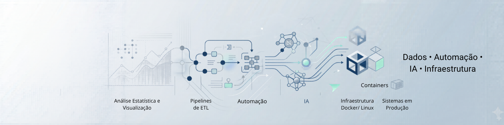

  
  

## Sobre

Especialista em Dados & Automação com IA na **Timbro Trading** e professor de IA, Automação e Claude Code na **Faculdade Impacta**. Economista pela UFF, com mestrado em Economia pela UFMG (modelagem econométrica e estatística aplicada).

Comecei na análise e visualização de dados e hoje entrego soluções digitais completas em produção: automações com N8N, agentes de IA, integrações, aplicativos, dashboards e a infraestrutura onde tudo isso roda.

## O que faço hoje

- **Timbro Trading** — automações com N8N construídas com agentes de IA (Claude Code) em todas as unidades de negócio; conferência de documentos de exportação e importação com Azure AI Document Intelligence, OCR e LLMs multimodais (**economia de ~R$ 500 mil**); gestão de contratos integrada ao DocuSign; dashboards de algodão, açúcar e aeronaves; migração das automações para Azure DevOps e AWS (Lambda, Step Functions, Bedrock).
- **Faculdade Impacta** — cursos *Claude Code na Prática* (15h) e *IA & Automação de Agentes com N8N* (28h), para profissionais com e sem perfil técnico.

## Resultados anteriores

- **Grupo Rigarr** — reativação comercial via WhatsApp com impacto de ~15% sobre vendas; central Chatwoot para empresa com 1.000+ funcionários (400–500 mensagens/dia no RH); painel de admissões usado em 50–60 admissões/mês; infraestrutura em VPS com Docker, PostgreSQL, backups e monitoramento.
- **MT2DATA** — primeiro MVP da empresa para a Mercedes-Benz: dashboard em R/Shiny com projeções de vendas de caminhões, com pipeline de dados a partir de APIs públicas (IPEA, IBGE, BACEN) e web scraping.

## Stack

  
  
  
  
  
  
  
  
  
  
  
  
  

## In English

Data & AI Automation Specialist at **Timbro Trading** and instructor of AI, Automation and Claude Code at **Faculdade Impacta**. Economist (UFF) with a master's in Economics (UFMG). I build production solutions — N8N automations, AI agents, integrations, apps, dashboards and the infrastructure they run on. Recent highlights: AI-powered review of export/import documents (~R$ 500k saved), a WhatsApp reactivation flow with ~15% sales impact, and a multichannel Chatwoot hub for a 1,000+ employee company.

## GitHub

  
  

